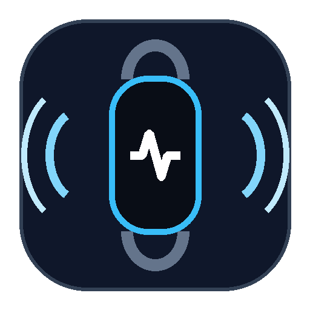

# AirNotify by qirke ⚡

<p align="center">
  
</p>

<p align="center">
  <strong>Wrist alerts, caller notifications, hourly chimes, and smart filtering for Google Fitbit Air.</strong>
</p>

<p align="center">
  <a href="https://github.com/qir3k/airnotify-by-qirke/actions/workflows/ci.yml"></a>
  <a href="https://github.com/qir3k/airnotify-by-qirke/releases"></a>
  <a href="https://developer.android.com/about/versions/14"></a>
  <a href="https://developer.android.com/jetpack/compose"></a>
  <a href="https://kotlinlang.org"></a>
</p>

---

## 📖 Overview

**AirNotify** is a standalone, companion Android application built for the **Google Fitbit Air** band.

By default, the official Google Health / Fitbit companion apps only trigger the band's vibration motor for wakeup alarms and emergency heart-rate warnings. AirNotify unlocks the built-in hardware vibration motor for everyday notifications, incoming phone calls, hourly wrist chimes, and custom VIP contact filtering.

---

## 🌟 Key Features

### 🔔 Smart App Notifications & VIP Filtering
- **Any Installed App:** Capture notifications from WhatsApp, Facebook Messenger, Telegram, Instagram, Google Messages (SMS), Discord, Slack, Gmail, and any app on your device.
- **Favorite Persons Only (VIP Filter):** Want Messenger notifications *only* when your girlfriend or family members message you? AirNotify filters notifications by sender name, letting through only your designated favorites and silently ignoring noisy group chats or acquaintances.
- **Custom Haptic Patterns:** Assign distinctive patterns per app (Single Pulse, Double Pulse, Triple Pulse, Urgent Burst) so you know what app is pinging you without looking at your screen.

### 📞 Phone Calls & Favorite Callers
- **Continuous Ringing:** Pulses the band continuously while an incoming call is ringing until you answer, decline, or silence it.
- **VIP Callers Filter:** Choose to vibrate for all incoming calls or only for starred/favorite contacts.
- **1-Tap Contact Importer:** Quickly sync and import starred contacts from your phone's address book.

### ⏰ Hourly Chime (Wrist Taps at :00)
- **Gentle Top-of-the-Hour Reminder:** Subtle wrist vibration at `:00` to keep track of time throughout the day without audio chimes.
- **Hands-Off Simplicity:** No clunky active window setup. It vibrates every hour automatically, and is seamlessly silenced during your Sleep / Inactive Window.

### 🌙 Unified Inactive Window / Sleep Hours (DND)
- **Natural Sleep Scheduling:** Define when you are inactive/asleep (e.g., 23:00 to 07:00), rather than having to specify daytime active hours.
- **Universal Silence Across All Features:** Automatically mutes App Notifications, Phone Calls, and Hourly Chimes during your sleep window, while keeping all of them active at all other times.
- **Granular Controls:** Choose exactly what to silence (Mute Notifications, Mute Calls, Mute Chimes).
- **Live Status on Dashboard:** Displays a sleep status banner when you are in your quiet window with wake time indication.

### 🛡️ Smart Health App Coexistence (Google Health / Pulse)
A common problem with third-party tools like AirBridge was Bluetooth GATT contention — simultaneous connections would cause `GATT Status 133` errors, breaking Google Health and Pulse sync. AirNotify eliminates this with a 3-layer coexistence system:
1. **On-Demand Transient Connection:** Never locks the BLE radio. Connects for milliseconds, sends the haptic command, cleanly disconnects, and applies a `250 ms` radio settle buffer.
2. **Smart Collision Backoff:** Detects active health sync transfer bursts and safely backs off with exponential delay (`1500 ms`) rather than spamming the radio.
3. **1-Tap Sync Pause & Quick Launch:** Dedicated card on the Dashboard allows pausing notifications for 5 minutes during manual health data sync, or opening Google Health / Pulse with automatic pause.

### 🔄 In-App Self-Updater (SonixLink-style)
- **GitHub Releases Integration:** Built-in update checker checks for newer releases from this repository.
- **Direct Download & Installation:** Downloads the latest APK with live progress and launches Android's Package Installer directly inside the app.

### 🎨 Material Design 3 (Material You)
- Built entirely with **Jetpack Compose** and **Material 3**.
- Native **Dynamic Color** support (adapts to your system wallpaper palette on Android 12+).
- Clean, intuitive tabbed navigation (Dashboard, Apps & Filters, Calls & Chime, Settings).

---

## 🏗️ Architecture & Protocol

AirNotify communicates with the Fitbit Air using the native GoldenGate protocol stack:
- **Gattlink & DTLS 1.2:** Establishes an encrypted session over characteristic `abbaff00-e56a-484c-b832-8b17cf6cbfe8`.
- **CoAP `/settings` Protobuf Protocol:** Reads and writes haptic intensity levels. Toggling between high/low/restore triggers the physical vibration motor confirmation without modifying persistent user settings.
- **Safe Recovery Checkpoint:** Checkpoints band haptic state in SharedPreferences before pulsing. If a Bluetooth disconnect occurs mid-pulse, recovery executes automatically upon reconnection.

---

## 📥 Download & Installation

1. Go to the [Releases](https://github.com/qir3k/airnotify-by-qirke/releases) tab.
2. Download the latest `app-release.apk` (or `app-debug.apk`).
3. Open the APK on your Android device and allow installation from unknown sources.
4. Launch **AirNotify** and grant the required permissions:
   - **Notification Access:** To read and filter incoming app alerts.
   - **Nearby Devices / Bluetooth:** To communicate with the Fitbit Air band.
   - **Phone & Contacts:** For incoming call alerts and contact name matching.
5. In **Settings**, tap **Scan Devices**, select your paired Fitbit Air, and tap **Test Vibration** on the Dashboard!

---

## 🛠️ Building from Source

### Prerequisites
- Android Studio Iguana / Jellyfish or newer (or command-line tools)
- JDK 17
- Android SDK 34

### Build Commands
```bash
# Clone the repository
git clone https://github.com/qir3k/airnotify-by-qirke.git
cd airnotify-by-qirke

# Run unit tests
./gradlew test

# Build debug APK
./gradlew assembleDebug

# Build release APK
./gradlew assembleRelease
```

Compiled APK locations:
- Debug: `app/build/outputs/apk/debug/app-debug.apk`
- Release: `app/build/outputs/apk/release/app-release.apk`

---

## 🚀 GitHub Actions CI/CD

- **`ci.yml`:** Automatically runs tests and builds the debug APK on every commit and pull request to `main`.
- **`release.yml`:** When a tag like `v1.0.0` is pushed (or triggered manually via **Workflow Dispatch**), it builds both Release and Debug APKs, creates a GitHub Release, and attaches the APKs for instant download.

---

## 📄 Credits & Acknowledgments
- Based on research and native stacks from [AirBridge](https://github.com/ashu-sa/AirBridge) and [fitbit-air](https://github.com/ThoreKoritzius/fitbit-air).
- Built by **qirke** / **qir3k**.
